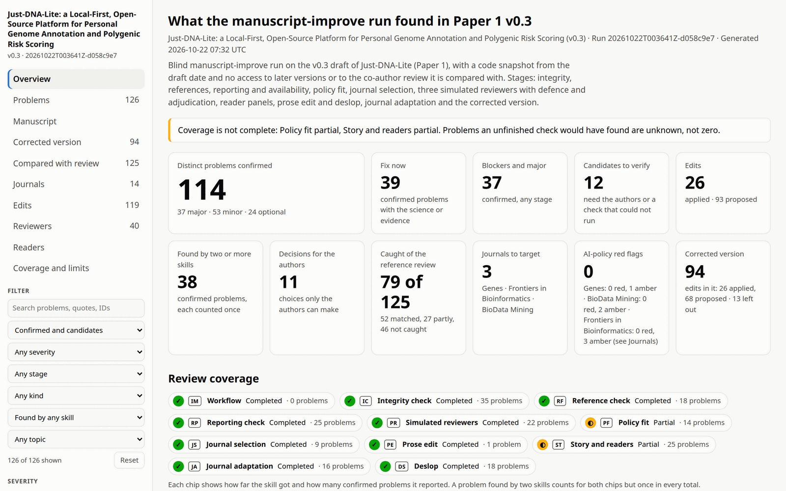
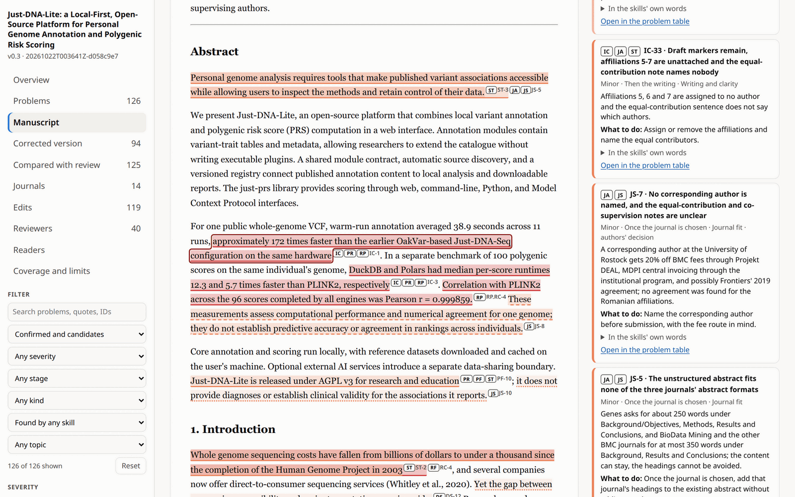
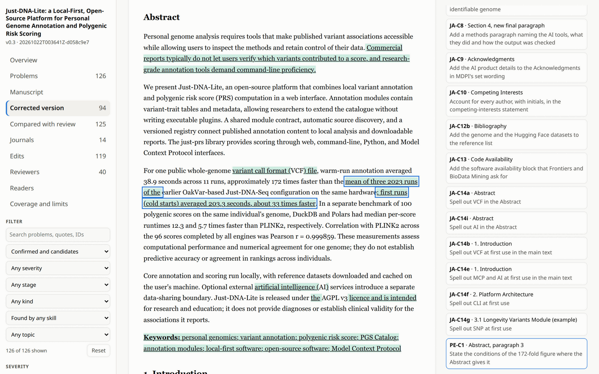
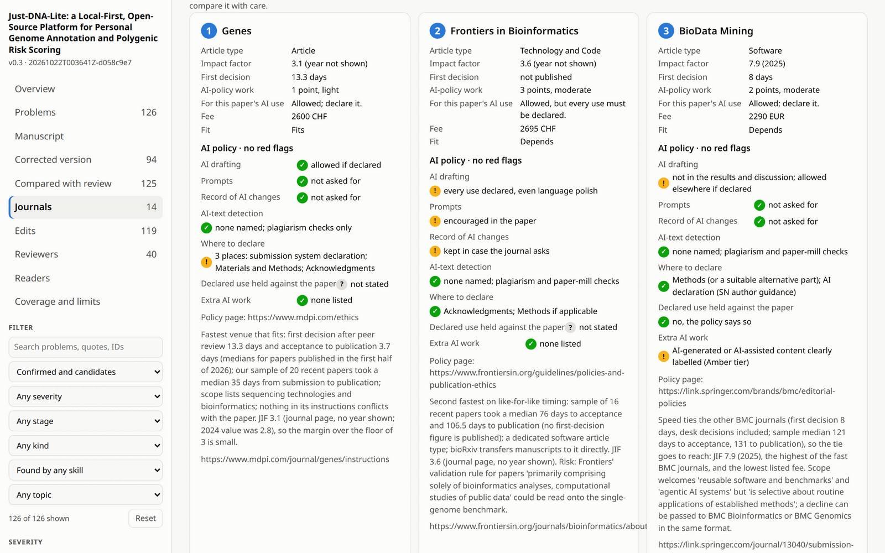
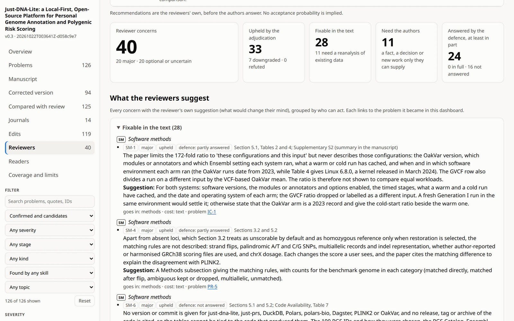
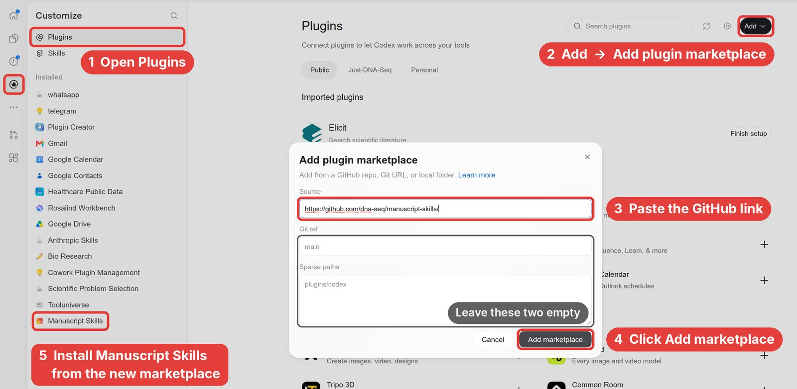

# Manuscript Skills

Skills that help scientists prepare manuscripts for publication, for
[Claude Code](https://claude.com/claude-code) and [Codex](https://github.com/openai/codex) (AI assistants
that work with the files on your computer). They review a draft, check its references and figures,
simulate the referees of a target journal, edit the prose, choose and prepare for a journal, and answer
the referees after a decision. They work with manuscripts written with or without AI assistance.

Start with `manuscript-improve`. One request runs the relevant checks and edits across the whole paper
and ends with a corrected version and a dashboard of what the run found. For a single task, use
[one of the sixteen focused skills](#choose-the-task-you-need).

The aim is to help you publish sound research with less avoidable delay, expense and paperwork. You
decide which journal to pursue and how to handle uncertain or burdensome requirements. Made by
[DNA Seq](https://github.com/dna-seq) and released under the MIT licence.

## What a run gives you



Every `manuscript-improve` run ends with `manuscript-dashboard.html`, one file that opens offline in a
browser. The dashboard above is from a run on draft v0.3 of a real software paper, Just-DNA-Lite. The
run found 114 confirmed problems, each counted once however many skills found it, and sorted them by
what to fix now. A co-author had reviewed the same draft separately; the run saw neither that review nor
any later version of the paper. Of the co-author's 125 points, the run found 79 (27 of them only in
part) and missed 46.

The dashboard is self-contained, so you can send it to a colleague as it is. The same review also comes
as a Word document: the corrected version as tracked changes signed by each stage, with the problems,
the questions for you and the reason for each edit as margin comments. Google Docs opens it with the
changes as suggestions. No question for you is ever written into the paper's text, where it could be
submitted by mistake.

<table>
<tr>
<td width="50%"><br><b>The paper itself</b>, each problem highlighted where a skill quoted it, with what is wrong and what to do beside it.</td>
<td width="50%"><br><b>The corrected version</b> as track changes: routine and evidence-backed fixes applied, the other changes proposed, all of it yours to accept in one step or one by one.</td>
</tr>
<tr>
<td width="50%"><br><b>The journals</b> chosen by your priorities, each AI rule shown as an icon, and a red flag for rules that can cost you, such as a ban on AI drafting or an AI detector.</td>
<td width="50%"><br><b>The simulated reviewers</b>: a recommendation per journal, and every concern with its suggestion, whether it held up when checked against the paper, and who can act on it.</td>
</tr>
</table>

## How it differs from other academic-writing skills

Several popular skill collections also review, edit and reference-check papers. Compared with the
most-starred of them in October 2026 ([the comparison](docs/skill-landscape-2026-10.md#where-each-skill-stands-against-popular-skill-repos-2026-10-24)),
these parts have no counterpart there:

- **Which rules apply to the study.** [manuscript-policy-fit](skills/manuscript-policy-fit/SKILL.md)
  works out which clinical, ethics and privacy requirements apply, including to authors' own public
  genomes and to papers referred between bioRxiv and medRxiv, and drafts the clarification.
- **Journals ordered by the authors' priorities, AI rules included.**
  [manuscript-journal-select](skills/manuscript-journal-select/SKILL.md) ranks preprint servers and
  journals by speed, reach, cost and how strict their AI policies are, with the deciding rule quoted and
  linked.
- **Readers as well as referees.** [manuscript-story](skills/manuscript-story/SKILL.md) has simulated
  readers say where they would stop reading, then repairs the text without dropping a caveat.
- **AI edits no person has reviewed.** For manuscripts that keep revision marks,
  [manuscript-revision-marks](skills/manuscript-revision-marks/SKILL.md) shows which passages an AI or
  agent rewrote that no co-author has checked since.
- **A run measured against a human review.** Given a co-author's review of the same draft,
  [the dashboard](skills/manuscript-dashboard/SKILL.md) shows which of its points the run caught and which
  it missed.

Where other skills do the same job, these parts add a check:

- **Every edit is checked by a script**, sentence by sentence, for a stronger claim, a dropped qualifier
    or a changed number or citation, and no declaration (consent, competing interests, funding, who did
  what) is written or changed without the facts you gave. The title, Abstract and Conclusions are checked
  against the body, so the summary never claims more than the Results.
- **The corrected version is re-checked by a reader who did not write it:** a fresh agent, which took no
  part in the review or the edits, says for each problem whether the corrected version fixed it, in part or
  not at all, or made it worse, and the number and reference checks run again; an edit that made something worse is undone before the result is handed over.
- **The upload files are checked too:** hidden text and prompts aimed at AI reviewers, LaTeX
  comments, leaked keys and location data in figures.
- **Figures are judged as printed:** at the journal's column width, in greyscale and as colour-blind
  readers see them, against the caption, the text and the code that draws them.
- **Data and code availability is looked up:** each accession, archive DOI and package name must resolve.

## Quick start

1. **Install the plugin.** In Claude Code, run:

   ```bash
   claude plugin marketplace add dna-seq/dna-seq-claude-marketplace
   claude plugin install manuscript-skills@dna-seq
   ```

   In the Codex app, open **Plugins**, choose **Add → Add plugin marketplace**, paste
   `https://github.com/dna-seq/manuscript-skills` as the source, leave **Git ref** and **Sparse paths**
   empty and click **Add marketplace**. Then install **Manuscript Skills** from the new marketplace; it
   appears under **Installed**.

   

   The checks also need [uv](https://docs.astral.sh/uv/), a small tool that runs the plugin's Python
   scripts.
2. **Share the manuscript, its supplements and its code.** Start the assistant in the manuscript's
   folder or give it the file paths. Markdown, plain text and LaTeX (with its bibliography files) are
   read directly; for Word or Google Docs, provide an export or use a document connection the assistant
   has. With the code repository, the paper's numbers and descriptions of its software are checked
   against the code, results and run logs.
3. **Ask in plain words**, for example:

   > Use manuscript-improve to improve this paper for submission. Show the before/after changes and
   > identify any decisions I need to make.

   By default a run applies routine fixes and the corrections the evidence settles (a wrong number, a
   citation, a claim reworded to what the results show), shows each one, and proposes the rest in a corrected
   version you can accept in one step. Say "fix everything" to apply the whole corrected version. Only
   choices that are yours alone (the paper's direction, which figures it has, new experiments, facts only
   you know) wait for you, all together at the end. Ask for proposals only if you want to approve each
   change yourself, or for a report only if the run must not touch the paper at all.

On first use the assistant asks, in one batch, only for what it cannot find (the manuscript files, any
code repository and where to save the runs) and how you want it to work: how much it may change by
itself, whether it may write into your manuscript file or must save each version as a new file, whether
full reports also appear in the chat, and whether to keep every intermediate file. Each
question comes with the recommended answer and the reason for it, so one "yes" accepts them all. The
answers are saved in `.manuscript-skills.yaml` beside your manuscript, and every skill reuses them.

## Choose the task you need

| Your task | Skill | What you get |
|---|---|---|
| Improve a manuscript from draft to submission | [manuscript-improve](skills/manuscript-improve/SKILL.md) | The skills below as one workflow, ending with the corrected paper (a separate file in the run folder, also shown as track changes), a dashboard, and the decisions left to you. |
| Improve the writing | [manuscript-prose-edit](skills/manuscript-prose-edit/SKILL.md) | Edits for clarity, grammar and your voice. Each sentence is checked: no claim grows stronger, no number, citation, scientific term, qualifier or null result changes, and no AI phrasing is added. Run on its own, it also lists the AI phrasing the draft already had and offers to remove it. |
| Remove AI phrasing ("deslop") | [manuscript-deslop](skills/manuscript-deslop/SKILL.md) | Stock LLM phrasing, boilerplate and empty rhetoric cut while the science and your voice stay, or only a list of the patterns. |
| Make the paper interesting to its readers | [manuscript-story](skills/manuscript-story/SKILL.md) | Simulated readers say where they would stop reading; edits then fix the opening, the result headlines and where caveats sit. The science and every caveat stay, and a change of direction is only ever offered as options. |
| Review the manuscript before submission | [manuscript-integrity-check](skills/manuscript-integrity-check/SKILL.md) | Unsupported claims, inconsistent numbers and statistics, reference problems, unfinished content, files that would leak private notes or hidden text, and submission requirements, with suggested fixes. |
| Check the references | [manuscript-reference-check](skills/manuscript-reference-check/SKILL.md) | Each reference's identity, authors, journal, year, volume and pages, retractions, withdrawn preprints and preprints since published, and whether the sources support the claims that carry the paper, with the passage quoted. |
| Check reporting standards and availability | [manuscript-reporting-check](skills/manuscript-reporting-check/SKILL.md) | An item-by-item check against the reporting guidelines for your study design (CONSORT, STROBE, PRISMA, ARRIVE and others). It also checks that your data, code and software can be found, and how statistics are reported. |
| Review the figures and tables | [manuscript-figures](skills/manuscript-figures/SKILL.md) | Every figure seen as it will be printed (at the journal's column width, in greyscale and as colour-blind readers see it) and every table as it is set (width, units, precision, empty cells), in the paper and its supplement. Each is checked against its caption, the text, the order it is cited in and the code that draws it; main-text items get the full review, supplementary ones a lighter one. You get a verdict per item (keep, change, merge, or move to or from the supplement), how to make the figures more compact (empty space measured, a page-wide figure tried in one column, figures of the same runs merged as panels), and the figures worth adding, including results the text gives only as numbers; your files are never overwritten. |
| Anticipate referees' objections | [manuscript-peer-review](skills/manuscript-peer-review/SKILL.md) | Reports from three simulated referees at your target journal, each quoting the paper, then what to fix first, including the work only you can do. No scores or acceptance odds. It can also draft your report when you are the referee. |
| Clarify study scope or policy requirements | [manuscript-policy-fit](skills/manuscript-policy-fit/SKILL.md) | Which clinical, ethics or privacy requirements apply, with the policy quoted and linked, and drafts of scope clarifications or replies to policy questions. |
| Choose where to preprint and submit | [manuscript-journal-select](skills/manuscript-journal-select/SKILL.md) | Two ranked lists ("ladders"), of preprint servers and of journals, ordered by your priorities: speed, reach, AI-policy burden, cost. Each venue is first checked for scientific fit, the validation you can afford, fees, review times and AI policies, with the deciding rule quoted and linked. |
| Prepare for a chosen journal | [manuscript-journal-adapt](skills/manuscript-journal-adapt/SKILL.md) | Length, structure and required statements adapted to the journal and shown before and after, plus submission materials and an AI-use disclosure where needed. |
| Answer referees and check the revision | [manuscript-reviewer-response](skills/manuscript-reviewer-response/SKILL.md) | A revision plan in the referees' own numbering with the decisions you need to make, a point-by-point response letter, and a check that the revision answers each comment. |
| Show colleagues what the review caught | [manuscript-dashboard](skills/manuscript-dashboard/SKILL.md) | The offline dashboard every improvement run ends with. Given a co-author's review of the same version, it shows what the run caught and why it missed the rest. |
| See who revised what, and which AI edits await review | [manuscript-revision-marks](skills/manuscript-revision-marks/SKILL.md) | For manuscripts with revision marks: notes in the Markdown or LaTeX source recording who rewrote each passage, when and why. The marks are checked and reported: which passages each review comment changed, in how many rounds and by whom, which AI edits no person has reviewed and which prose no round has read. You also get a heat map, a review PDF with those edits shaded, a PDF measured against a page limit, and the list a changelog between two rounds starts from: every passage that changed, with what it was and what it is now, for the co-authors. |
| List the people behind the revision marks | [manuscript-mark-people](skills/manuscript-mark-people/SKILL.md) | The people in the repository, from its history and author lists, kept apart from AI models and bots. You confirm the list, so an unlisted name never counts as a person's review. |
| Have more than one AI model read the paper | [manuscript-other-models](skills/manuscript-other-models/SKILL.md) | Only when you ask: the simulated referees and readers also read on another model, through the command-line agents you already use and pay for (from Claude Code on Codex, from Codex on Claude Code, or on Gemini), using each one's own sign-in: provider API keys in your environment are not passed on. Each seat runs in a fresh session in its own copy of the paper: Claude Code cannot read outside it, while Codex and Gemini can write only there and are told to read nothing else. Every report says which model wrote it. |

manuscript-improve runs the other skills as its stages, so you do not need to run them first. Each
skill also works on its own when you want only that service: a paragraph edit needs no full manuscript
review, and a full submission review includes the reference checks where relevant. Skills cover the whole paper by default;
you can ask for selected sections or one stage at a time instead.

## What leaves your computer

- Reference and availability checks look up public identifiers online: DOIs, PMIDs, accessions,
  package names and links in the text. A reference without a working identifier is searched in Crossref
  by its own text, and a resolved reference's record is read from Europe PMC as a second source. Nothing
  else from the manuscript is sent.
- Journal requirements are read from the journals' own pages. To see where named colleagues publish, journal
  selection sends their names to OpenAlex, and only on request.
- AI-text detector checks run only when you ask. The default detector runs on your computer; a hosted
  one requires your agreement before the manuscript is sent to it.
- Simulated referees and readers run on a second AI model only when you ask for it by name or save it for
  the project. The reading copy of the paper then goes to that model's provider, under your own account
  with its command-line agent.
- Reports, the corrected version and the dashboard are saved in the manuscript project or the output
  folder you chose, with the evidence behind each finding. Unrelated downloads may still use temporary
  storage.

## What a run leaves in your folder

Each run gets its own folder, by default under `reviews/` in the manuscript's folder. It holds:

- the run index (`README.md`), which links everything below;
- each skill's report and, for an improvement run, the dashboard and the corrected version of the paper;
- the evidence behind each finding: every simulated referee's and reader's report, each check and its
  output, the commands that ran and the before and after of each edit.

The evidence is many files, often more than a hundred for one skill. It is kept because the work depends
on it: a resumed run and the dashboard read it instead of repeating the work, and you can trace any
finding to the check, referee or reader behind it. This is the recommended setting, `keep: everything`.
If you only want to see the outcome, choose `keep: results`: once a run is finished, everything except
the index, the reports, the dashboard and the corrected version is packed into one `evidence.zip` in the
same folder, and unpacked again if the run continues. Every file is kept in that archive: the loose copies are
removed only once it is verified. The assistant asks which you
prefer on first use; to change it later, say "keep only the results" or "keep everything".

What you open goes beside the manuscript as well, named after it:

- `paper.dashboard.html`, the dashboard of the latest run (each run folder keeps its own);
- `paper.review.docx`, the corrected version as a Word document with only what needs you: the proposals as
  tracked changes, and comments for your questions, your decisions and the open major problems. The fixes
  the run applied are already in its text. If you already have a different one, which you may have
  commented in, the new one is saved beside it with the date in its name (`paper.review.20261024.docx`),
  never over it;
- `paper.changes.xlsx`, every change the run applied (before, after, why, the problem it answers), what
  needs you, the open problems and the held proposals, one sheet each, to filter in Excel or Google Sheets;
  kept the same way;
- `paper.proposed.md` (or `.tex`, as your manuscript), the corrected version, kept the same way;
- from journal selection, the journal ladder, the venue requirements and the shared record.

With `versions: immutable` the dashboard is kept the same way, and the edits a run applies go into a new
version beside your file (`paper_v2.md`), never into `paper.md` itself.

```
paper/
├── paper.md                  your manuscript
├── paper.dashboard.html      the latest run's dashboard
├── paper.review.docx         what needs you, in Word: proposals, questions, decisions
├── paper.changes.xlsx        every applied change, to filter
├── paper.proposed.md         the corrected version (your manuscript's own format)
└── reviews/
    └── 20261024T101500Z-3f2a91c0/   one folder per run: index, reports, evidence
```

## Watching a run in Claude Code

In Claude Code 2.1.299 or newer, the plugin shows where a run stands while it works: a status line, a
**Manuscript run** pane with each phase's progress, counts, the referees' recommendations, how many
decisions are held for you, the run's settings and buttons that open its outputs, a **Decisions** pane, a band
above the prompt when the run waits for your answer or decisions wait for you, and a short notice as each
stage finishes. The band's **Open decisions** opens the Decisions pane: every decision with its whole
summary, each unfolding to where it is, why, and what it suggests, with buttons to answer it: **Go ahead**
as it suggests, **Leave as is**, or **Write answer**, which puts the decision in the prompt box for your own
words. **Send answers to Claude** sends the answers you chose in one message, as yours, to the session the
pane is in; until then they stay in the pane, for this session only. The band, the panes and the status line
name the manuscript (its file's name, or its project's folder where the file is just `manuscript`, and the
version folder), and the panes show its title, so a session that watches another paper's run says which
paper waits for you. The progress pane opens by itself in the session that runs the workflow;
anywhere else, `/manuscript-status` opens it for the newest run of the folder's project, `/manuscript-status
PATH` for a run or project folder, and `/manuscript-status forget` stops watching. It only reads the run
folder. Older Claude Code releases load the skills as before, without the view. Codex has no equivalent, so
Codex users do not get the view: there the run's state stays in the chat and the run index.

## More details

<details>
<summary><b>Example requests</b></summary>

For a prose edit:

> Edit the Discussion for clarity and readability. Preserve the claims, numbers, citations and
> uncertainty, and keep our voice. Show me what changed.

For deslop:

> Deslop the Discussion. Cut boilerplate and repeated AI phrasing while keeping our claims,
> uncertainty, numbers and citations. Show the consequential changes.

Use `manuscript-deslop` for a focused pattern check or cleanup, and `manuscript-prose-edit` for broader
language editing; either can list the patterns without editing. A prose edit run on its own ends by offering
a deslop pass for the patterns the draft already had and the edit left in place. If another installed plugin also offers
a "humanizer", name `manuscript-deslop` to get this plugin's version, written for manuscripts.

For the review dashboard (manuscript-improve builds it at the end of every run):

> Visualize what this manuscript-improve run caught and changed so I can show my colleagues. Use the
> saved evidence, separate problems from edits, and show what remains open and what was not checked.

> Compare this run on v0.3 with our co-author's comments on the same version: which did it catch, which
> did it miss, and why.

> Give me the corrected version as a Word document with the review as comments, so my co-authors can
> accept or reject each change.

For the figures:

> Check our figures as they will look in Bioinformatics: can every label be read in print, do the
> numbers match the text, and which figures should go to the supplement? Our plotting code is in
> analysis/. Don't change the figure files.

For the story:

> Our paper got boring after two rounds of referee comments. Compare it with the first draft from a
> reader's point of view, then make it interesting again without dropping any caveat the referees made
> us add. Keep the privacy angle; if another angle would read better, give us options.

For references:

> Verify the references in this manuscript. Check whether the sources support the main claims in the
> Abstract and Discussion, and distinguish incorrect citations from sources you could not verify.

For journal selection:

> Suggest journals for this computational aging paper. We can reanalyse public datasets but have no
> wet-lab budget. Compare scientific fit, publication costs and review speed. We used AI to revise the
> text, so explain the relevant writing policies too.

Journal selection reads the venues first and orders both ladders by a default you can see (speed, then
reach, AI-policy burden and cost) until you state your own priorities; it asks them once, among the
decisions at the end (what matters most, an impact-factor floor, who pays the fee and up to what amount),
reorders on your answer and keeps it in the shared record. A venue whose fee you would pay stays "depends"
until a budget is known, and no venue is left out for its AI rules unless you say so. Before handing a
ladder over, it reads each journal's validation requirements and each preprint server's screening rules (what
the server declines, and the papers it sends to another server) that nobody has read yet; a ladder that still
shows "could not be checked" for an unread rule says it is not finished, and ranks that venue below every
venue whose rules were read. The plugin ships these rules for the
common preprint servers, and the preprint ladder warns when two servers may pass a paper back and forth, as
bioRxiv and medRxiv can with a tool paper about personal genomes. You can ask for a
fuller interview instead: what AI did in each section, which AI-policy burdens you refuse, and where
named colleagues publish. Journal adaptation checks whether a target journal's AI policy has changed
since it was last read.

Every venue fact a run reads (a fee, a review time, an article type, a referee form, a figure rule, an AI
policy) is kept in the plugin's journal catalogue with the page and the date it was read, so a later run reads
a page again only for facts that have grown old: an AI policy after 60 days, an impact factor after the yearly
Journal Citation Reports release, anything else after a year. An installed plugin keeps what its runs read in
`~/.config/manuscript-skills/venues.yaml` on Linux, beside your settings, which plugin updates never replace.

For adaptation to a journal:

> Prepare this manuscript for initial submission to [journal]. Apply its abstract and length rules,
> check the required statements and draft the cover letter. Use free-format submission if it is allowed.

For a submission review:

> Review this manuscript before submission to [journal]. Prioritise problems that could affect the
> scientific conclusions or prevent review. Separate required fixes from optional improvements.

For reporting standards and availability:

> Check this genetic-association paper against the reporting guidelines that apply to it, and check
> that every accession, repository and package in the availability statement can be found.

For a simulated referee review:

> Show me what three referees at [journal] would send back on this draft, then what we should fix
> first. Tell me which concerns I can fix in the text and which need new work.

Without a named journal, the referees review for the journal in your shared record, or for each of the
top three journals on your ladder.

For a response to referees:

> We received a major revision. Plan it from this decision letter, keep the referees' numbering and
> list the decisions we need to make. Later, draft the response letter and check it against the revised
> manuscript.

For revision marks, where the manuscript keeps them:

> Which passages has no one checked since the AI rewrote them? Give Anna a PDF with those passages
> highlighted, and list the paragraphs no review round has touched.

For a scope or ethics question:

> This paper evaluates an annotation tool using my own publicly released genome. Check which
> requirements apply and clarify the wording so it accurately describes the study and data.

The policy-fit skill also helps with preprint screening decisions, including papers referred between
bioRxiv and medRxiv, and drafts factual clarifications based on the notices you received.

</details>

<details>
<summary><b>The full workflow, step by step</b></summary>

A request that names every stage:

> Use manuscript-improve to improve this paper for submission. Review the claims and references, check
> applicable policies, recommend suitable journals, edit the prose and adapt the paper to the chosen
> journal. Use our existing context, show the before/after changes and identify any decisions I need
> to make.

The stages:

1. **Review the draft and references.** The integrity, reference and reporting checks find unsupported
   claims, citation problems, inconsistent numbers, reporting gaps and missing material. A panel of
   simulated referees reviews the draft too, by default for this full workflow. Every figure is looked
   at as it will be printed and checked against its caption, the text and its code.
2. **Resolve scope and choose a journal.** Where the study raises clinical, ethics or privacy questions,
   the policy-fit assessment says which rules apply. The preprint servers and journals that fit your
   research and publication budget are then ordered into two ladders by your priorities, and the
   sections every venue on them shares are adapted. An existing target is used if you have one.
3. **Revise the paper.** Supported problems are corrected and the prose improved, with the results and
   their qualifications preserved; substantive claim changes are kept apart from language edits. Then
   the formulaic AI phrasing the draft already has is removed (deslop), and the story is checked against
   the version you started from and repaired within the direction you chose.
4. **Prepare for the chosen journal.** Its length, structure and section requirements are applied, and
   the required statements and submission materials drafted.
5. **Check the changes and show them.** The corrected version is built with every applied edit and
   every proposal as track changes, with one choice per contested passage. The affected citations,
   claims and submission requirements are then verified in it, and the dashboard shows what the run
   found, changed and left open.
6. **Finish for submission.** Once the code, data and results are final: archive the code release with a
   DOI, complete the declarations, the AI-use statement and the cover letter, and check the files you
   will upload. These items wait until then and do not hold up work on a draft.

The skills work on the same manuscript and share findings across these stages. Some stages may already be
done or unnecessary for your study. Preparing a manuscript does not submit it to a journal. When a
decision arrives, `manuscript-reviewer-response` takes over: it plans the revision from the referees'
comments, drafts the response letter and checks it against the revised manuscript.

For work that spans several sessions, the assistant can keep a small
[shared record](skills/manuscript-integrity-check/references/manuscript-record.md) beside the manuscript:
the chosen journal or the ladders, your priorities, completed checks and open issues, so later steps
reuse earlier work. It is created when the work spans sessions, when journal selection records your
priorities and ladders, or when you ask for it.

</details>

<details>
<summary><b>Stopping to review: by section, by stage, or before edits</b></summary>

By default the assistant completes the whole-paper task from the context you gave and asks only for
missing information that changes the work. You can ask it to stop for review instead, with a single
skill or the full workflow:

- **By section:** "Edit the whole paper, section by section. Show before/after changes for each section
  and wait for my response before moving on." You can also name a single subsection to work on.
- **By stage:** "Use manuscript-improve one stage at a time. Cover the whole paper at each stage and
  let me review the findings or changes before continuing."
- **Before applying edits:** "Prepare proposed changes separately. Show me the original and proposed
  text, and wait for me to accept them before updating the manuscript."
- **No edits at all:** "Report only, do not edit the paper." The run reviews and reports; it writes no
  corrected version and changes no file. Save it for the project with `edits: none`.
- **With an interview:** "Interview me about the decisions we need to make." This can cover journal
  priorities, scientific wording, restructuring or how to handle review findings, or only one decision
  or stage.

Changes are shown as a diff, as tracked changes where available, or as the original and revised passage;
for a stage such as journal selection, you review the recommendations and tradeoffs. Accepted edits and
decisions carry into the next step, and you can ask to revisit them.

While it waits for your answers, the assistant finishes the checks and edits that do not depend on them.
If it can ask while it works, it does; otherwise it presents the remaining decisions together at the end.
Only the dependent work waits, and silence never counts as approval.

</details>

<details>
<summary><b>What to share and which context to add</b></summary>

The skills read Markdown, plain text and LaTeX directly; with LaTeX, include the bibliography files,
because the reference checks read them. For Word or Google Docs, use a document connection your
assistant has or provide an export. For a passage edit, paste the passage.

Include the supplements and, when the paper describes software or analyses, its code repository. The
simulated referees and the reference check read the supplementary files, including their reference
lists. With the repository, a number that matches no table, a quoted version or a description of what
the software ships is checked against the project's own files (benchmark tables, run logs, release tags,
the code that writes the output) before it is reported, and the assistant asks you only what those files
leave open. The code is context for the review; the skills do not edit it.

Add the context that matters to your request, for example a target journal, article type, publication
budget or deadline. For journal selection, say which additional analyses or experiments are feasible.
If you have already received an editorial decision, include the relevant comments. The assistant uses
what you provide and asks about missing facts that would change its answer.

</details>

<details>
<summary><b>How to read the results, and their limits</b></summary>

Reports quote the passage each finding is about, name its section, and link anything you need to open
(a DOI, a database record, a journal's policy page). The work is grouped by when you can do it: first
the science and the evidence, then the writing, then what depends on the chosen journal, and last what
waits until the code, data and results are final, such as archive DOIs, declarations, the AI-use
statement and the cover letter. Those last items are not problems with a draft.

You decide how to handle a journal's policy. If something you ask for conflicts with a journal's rule,
for example a ban on drafting text with AI, the assistant still does it, names the conflict once with its
practical consequence and lists it with your other decisions.

Prose editing aims to preserve your scientific meaning, including uncertainty and limitations. The
checks can flag altered numbers, citations and terminology, and claims that became stronger or lost a
qualifier. They help catch mistakes; review the edited text before you use it. A request for "punchier"
wording improves the prose without raising the certainty of a claim.

The simulated referees show objections early, while you can still act on them. Each reviews for a real
journal whose pages were read for it, and writes the report a referee would send: a recommendation
(accept, minor revision, major revision or reject), a summary, strengths, and major and minor concerns.
Every concern quotes the passage it is about and is checked against the rest of the paper before it
reaches you, and a second part turns the reports into your list of what to fix, in the order above. The
panel has never been calibrated against real editorial decisions, so it gives no scores, acceptance odds
or predicted decision, and its recommendations are labelled as coming from simulated referees. Concerns
that need new analyses or data are listed for you to decide on; nothing is added to the paper on your
behalf. The story skill's simulated readers do not replace scientific referees either.

Reporting guidelines are checked when they fit your study design; a missing checklist item is a
requirement only when your target journal asks for that guideline. Data under controlled access, such
as dbGaP or EGA, is reported as restricted, which the availability check accepts as a legitimate route.

Reference checking keeps a source's identity apart from its support for a particular sentence: a DOI
that resolves to the right paper does not establish that the paper supports your claim. The assistant
reads the relevant source material and says what it could not verify; a failed lookup alone is not
evidence that a reference was invented. A Crossref match for a reference without a working identifier
stays a candidate for you to confirm.

Journal coverage is strongest in bioinformatics, genomics, genetics and aging research. The catalogue
also includes preprint servers and policy notes for machine-learning conferences. Entries have sources
and dates, but some are incomplete and policies change, so the assistant checks the current requirements
that affect its recommendations and reports material uncertainties. Review-time comparisons distinguish
initial editorial decisions from decisions after external peer review.

For ethics and privacy questions, the assessment depends on what the study actually did, the data used
and the chosen journal. Public reanalysis, an author's voluntary release of their own data and research
involving recruited participants can raise different requirements. Applicable exceptions are considered;
a missing declaration alone does not establish that an approval was required.

AI-use statements draw on your account of what the tools did and the journal's required fields and
exemptions. The run's edits are not counted for it unless you ask, for example for a journal with a strict AI
policy. Then the part covering that run is pre-filled from what its stages changed, marked as covering that
run only, and you are asked once about your own use outside it. Nothing is pieced together from older
versions or commit history. Detector scores measure style and are often wrong: they cannot show who wrote a passage,
and a low score guarantees nothing at submission.

</details>

<details>
<summary><b>Settings and saved runs</b></summary>

On first use with a manuscript project, the assistant saves your answers in `.manuscript-skills.yaml`
in that project, and every skill reuses them, so a later skill or revision does not restart the
questions. Only what you answered is saved: a setting you skipped uses its default, unsaved, until you
choose. It asks again only when you request it or something no longer matches, such as a missing
source or a destination it cannot reach. Related papers can be linked without sharing or overwriting
their separate choices.

Ask the assistant to change a setting for one request or for the project. What you say in the
conversation overrides the project's saved choices, and those override your global defaults in
`~/.config/manuscript-skills/settings.yaml` on Linux. A one-run override is not a lasting preference.

| Setting | Choices (default first) | What it changes |
|---|---|---|
| `edits` | `apply`, `conservative`, `propose`, `none` | How much a run changes by itself. `apply` makes every change that needs no decision of yours: routine corrections, the corrections the evidence for a confirmed problem settles (a number, a citation, a claim reworded to what the results show) and the improvements within your direction (restructuring, a new emphasis, additions, cuts of boilerplate). You check them in `paper.changes.xlsx`, and the Word review keeps only your questions, the remaining proposals and your decisions. `conservative` is more cautious: it applies the routine and evidence-backed corrections (for the story stage, also edits that keep the paper's direction) and proposes the rest, each a comment; `propose` applies nothing and lets you approve each change one by one, with every edit and problem in the Word review; `none` is report only: every request becomes a review, each problem comes with the kind of change that would fix it, and no file of yours changes. Under every setting the paper's direction, which figures it has, new experiments and facts only you know stay your decisions, asked once at the end. Every mode but `none` ends with the corrected version as a separate file, which you can accept in one step ("fix everything"), and exact consequential before/after text is shown promptly in the chat, even with file reports. |
| `versions` | `in-place`, `immutable` | Where the edits a run applies go. `in-place` writes them into your manuscript file; the version before them is your last git commit or, without git, a copy saved beside it (`paper.pre-edit.md`). `immutable` never changes a file once written, for those who keep each version as a file of its own: the edits go into a new version beside it (`paper_v2.docx` becomes `paper_v3.docx`, `paper.md` becomes `paper_v2.md`), which the next run starts from, and the dashboard, Word file and corrected version of each run go beside the earlier ones under dated names instead of replacing them. |
| `reports` | `file`, `chat`, `both` | `file` saves each report and gives the headline and urgent findings in the chat; `chat` and `both` show the whole report there. The run evidence is saved in every mode. |
| `keep` | `everything`, `results` | What stays in a run's folder once it ends. `everything` keeps every intermediate file, which later steps and the dashboard read and which let you trace each finding; `results` keeps the index, the reports, the dashboard and the corrected version, and packs the rest into `evidence.zip` (see [What a run leaves in your folder](#what-a-run-leaves-in-your-folder)). |
| `peer_review` | `auto`, `on-request`, `off` | Whether a whole-manuscript improvement includes the simulated referee panel: three referees plus a defender, who tests their concerns against the paper. Focused tasks never expand into peer review. |
| `readers` | a skimmer, a potential user and an informed outsider | Who reads the paper for `manuscript-story`. Each reads in its own order and says where it would close the paper, not just where attention dipped. Save your own audiences with `project.py configure ROOT --reader "clinician: ..." --reader ...`. |
| `other_models` | none | Other models the simulated referees, readers and critics also run on, through [manuscript-other-models](skills/manuscript-other-models/SKILL.md): `project.py configure ROOT --other-model codex/gpt-5.6-sol`; `--one-model` returns to the host model alone. Every seat on another model sends the reading copy to its provider. |

Every run has an index and one subfolder per applied skill. Reports, the simulated readers' and
referees' actual responses, checks, contradictions, blocked sources, failed attempts and before/after
passages stay there to inspect, and the assistant's reply links the index and reports. Failed commands
are kept after a successful retry, and stages that did not run or did not finish are labelled.
`runs.py validate RUN --final` checks the delivered files and panel coverage; it cannot establish
scientific correctness or verify that the conversation actually displayed an excerpt.
`project.py resolve SOURCE --json` shows the settings in force without changing them. The shared
[project and run contract](skills/manuscript-integrity-check/references/project-workflow.md) has setup,
command examples and the limits of these checks.

</details>

<details>
<summary><b>Other ways to install, and what else the checks need</b></summary>

To install in Claude Code directly from this repository instead of the DNA Seq marketplace:

```bash
claude plugin marketplace add dna-seq/manuscript-skills
claude plugin install manuscript-skills@manuscript-skills
```

In Codex, to add the whole **DNA Seq Genomics** catalog instead, paste
`https://github.com/dna-seq/dna-seq-claude-marketplace` as the marketplace source and install
**manuscript-skills** from it.

The plugin installs all seventeen skills. The automated checks need [uv](https://docs.astral.sh/uv/) on
the computer running the assistant; their dependencies install on first use. Building a PDF from a
marked manuscript also needs the document tools [pandoc](https://pandoc.org/) and
[tectonic](https://tectonic-typesetting.github.io/), which uv does not install. Looking up references
and current journal policies requires internet access. Ask the assistant to check the setup if needed.

</details>

## Development

`uv run pytest` runs the offline tests of every script, and, where Claude Code 2.1.299 or newer is on PATH
(or named in `CLAUDE_BIN`), `claude plugin validate .` and `claude plugin test .` for the progress view in
`hooks/progress/`. Behavioural evaluations of the skills, with
seeded manuscripts and clean controls, are described in [evals/README.md](evals/README.md). The survey of
related projects behind the current design is in [docs/](docs/skill-landscape-2026-10.md).

## Licence

[MIT](LICENSE). Journal policies remain governed by the journals' own published guidance. Design ideas
borrowed from other projects are credited in [NOTICE](NOTICE).
