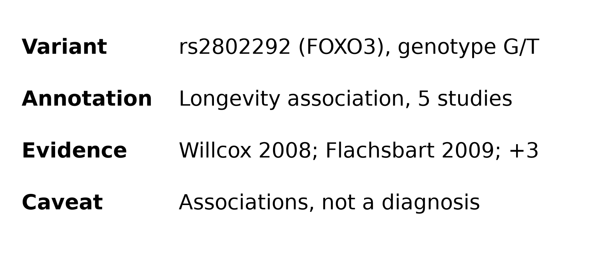
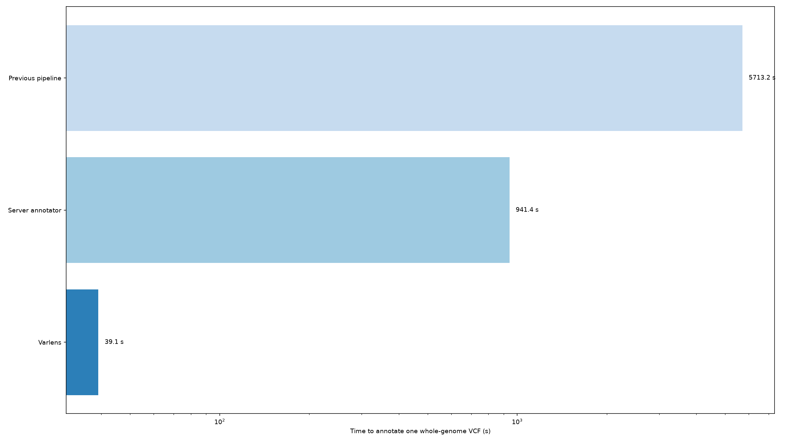
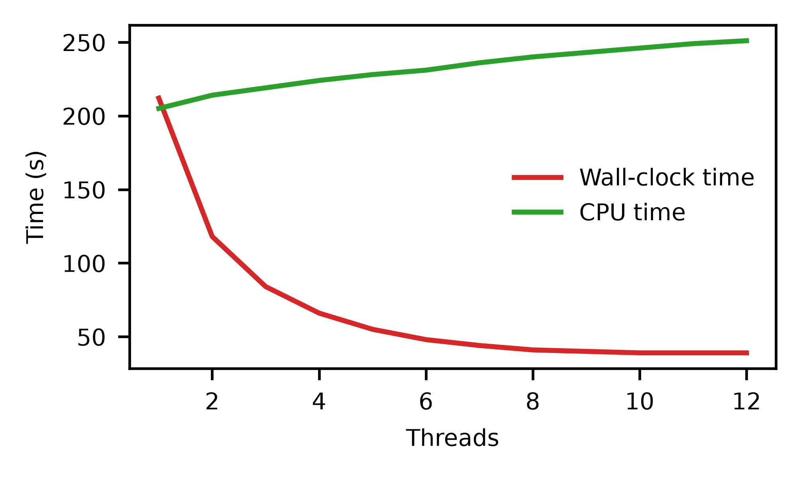
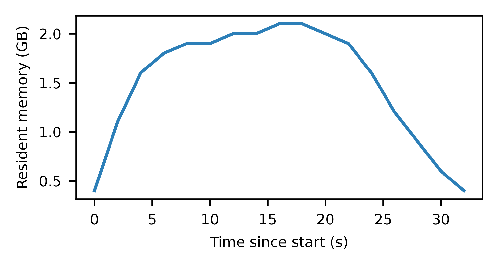

# Varlens: annotating a personal genome on your own computer

## Abstract

Varlens annotates one whole-genome variant file on a desktop computer in a median of 31.4 seconds, without
uploading the genome anywhere. Each result names the studies behind it.

## 1. Introduction

People who receive their genome as a variant file cannot read it, and the services that can read it ask
them to upload it. Varlens reads the file locally and shows, for each annotated variant, what the
association is and which studies report it (Figure 1).

**Figure 1.** One row of a Varlens report, as a user sees it: the variant and genotype, the annotation, the
studies behind it and the caveat shown with every association.

## 2. Methods

Varlens joins the variants of a VCF file with annotation tables by chromosome, position and allele. We
timed five runs of each tool on one whole-genome VCF (4.6 million variants) on a desktop computer with
12 threads.

## 3. Results

### 3.1 Speed

Varlens annotated the genome in a median of 31.4 s, against 940 s for the server annotator and 5,712 s for
the previous pipeline (Figure 2). The result does not depend on the size of the thread pool (Figure 3).

**Figure 2.** Time to annotate one whole-genome VCF with each tool: the median of five runs, on a
logarithmic scale.

**Figure 3.** Wall-clock and CPU time of Varlens for thread pools of 1 to 12 threads.

### 3.2 Agreement

Table 1 compares the annotations with a manually curated reference.

**Table 1.** Agreement with the curated reference set (2,184 variants).

| Tool | Agreement | Disagreement |
|---|---|---|
| Varlens | 2,171 (99.4%) | 13 |
| Server annotator | 2,160 (98.9%) | 24 |

**Figure 4.** Resident memory of Varlens during one annotation run.

## 4. Discussion

Varlens makes a personal genome readable without handing it to a service. It reports associations, not
diagnoses, and its annotations are only as current as the tables it joins.

## Code availability

The plotting code is in `code/` and the timings in `data/runtime.csv`.
